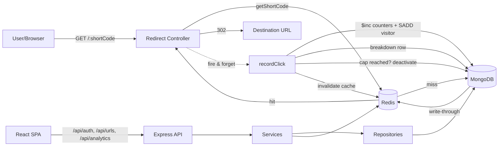

# Architecture

## High-level overview

SmartURL is split into two deployables sharing a single MongoDB + Redis pair.

```
┌─────────────┐   HTTPS    ┌──────────────────┐   /api/*   ┌───────────────────┐
│  Browser    │ ─────────► │   React SPA      │ ─────────► │   Express API     │
│  (frontend) │            │   (Vite/TS)      │            │   (Clean Arch)    │
└──────┬──────┘            └──────────────────┘            └─────────┬─────────┘
       │  GET /<shortCode>  (direct, no SPA)                          │
       └──────────────────────────────────────────────►  Redis ◄──────┘
                                                          ▲
                                                          │ cache-aside
                                                ┌─────────┴─────────┐
                                                │     MongoDB       │
                                                └───────────────────┘
```



## Backend layering

The backend follows **Clean Architecture** — dependencies point inward, each layer knows nothing about the layers above it.

| Layer | Directory | Responsibility |
|---|---|---|
| Routing | `routes/` | Map HTTP method + path to controllers |
| HTTP | `controllers/` | Parse/validate input, call services, shape responses |
| Middleware | `middlewares/` | Auth, validation, rate limiting, error handling |
| Business logic | `services/` | Use cases: auth, shortening, redirect, analytics, cache, expiry |
| Data access | `repositories/` | Mongo/Redis operations, aggregation pipelines |
| Models | `models/` | Mongoose schemas and indexes |
| Utils | `utils/` | `ApiError`, `ApiResponse`, base62, geo, device, serializers |

### Request flow (example: create a link)

```
Express → urlRoutes (authenticate → rate-limit → validate)
       → UrlController.shorten
       → UrlService.shorten (generate code, handle collisions, write-through cache)
       → UrlRepository.create
       → ApiResponse.sendSuccess (201)
```

## The redirect hot path

`GET /:shortCode` is the highest-traffic endpoint, so every decision is optimised for it.

1. **Redis lookup** (`short:<code>`). On a hit the redirect is served with **no DB I/O**.
2. **Cache miss** → MongoDB lookup (cache-aside), then write-through to Redis.
3. **Cache negative** (`_neg` marker) → 404 immediately, shielding the DB from hot-miss traffic for `NEGATIVE_CACHE_TTL` (60s).
4. **Expired / inactive** links → redirected to `${CLIENT_URL}/link-unavailable?reason=...`, deactivated eagerly, and the cache is invalidated so state converges.
5. **Click analytics** are recorded **fire-and-forget** (`void recordClick(...)`) so telemetry never blocks the redirect.
6. `Cache-Control: no-store` on the 302 prevents browsers/proxies from caching the redirect (which would swallow future analytics).

### Unique visitors

Redis `SADD uv:<urlId> <ip>` with a 30-day TTL gives O(1) dedup; when Redis is down this falls back to a Mongo query for first-visit-by-IP.

### Click budget (maxClicks)

Each recorded click does an atomic `$inc` on the URL counters, then a conditional `updateOne` that deactivates the link when `clicks >= maxClicks` is reached. The deactivation invalidates the cache key (by **short code**, not Mongo id), so the next hit falls through to the DB and is blocked.

## Caching strategy

| Key | Content | TTL | Purpose |
|---|---|---|---|
| `short:<code>` | serialized link payload | `CACHE_TTL` (24h) | cache-aside redirect resolution |
| `short:<code>` = `{_neg:true}` | negative marker | 60s | absorb hot 404s |
| `uv:<urlId>` | set of IPs | 30d | unique-visitor dedup |

Every mutation (create, update, delete, deactivate) invalidates the affected key, keeping the cache eventually consistent. All cache operations are wrapped in try/catch — a Redis outage degrades to DB-only lookups without crashing.

## Authentication & security

- **Registration/login** → verify credentials with `bcryptjs`, sign an **access token (15m)** and a **refresh token (7d)**.
- The refresh token is **SHA-256 hashed** before storage; each refresh **rotates** it (new token, old one revoked). Refresh uses a single-flight pattern so concurrent 401s share one refresh.
- The refresh token is delivered in an `httpOnly` cookie (`smarturl_refresh`) scoped to `/api/auth`, so it is not readable by JS and not sent to unrelated API paths. `SameSite` is `None` in production (the frontend is cross-site on Vercel) and `Lax` in development; cookie endpoints are additionally guarded by an Origin check.
- `GET /api/auth/me` and the protected routes read the access token from the `Authorization: Bearer` header.
- **Rate limits:** per-endpoint limits on `/api/auth/register`, `/api/auth/login`, `/api/auth/refresh`, `/api/auth/logout`, `POST /api/urls` (keyed by user), and the redirect hot path `GET /:shortCode`; trusted-proxy aware (`trust proxy 1`, correct for single-hop Render — re-check if another proxy is added in front).
- Other hardening: Helmet security headers, CORS allowlist with credentials, `express-mongo-sanitize` against `$` operator injection, request body size cap (oversize → 413), `morgan` access logging (`combined` format in production, query strings stripped).

## Data model

- **User** — email (unique), name, password hash, `isEmailVerified`.
- **RefreshToken** — hashed token (unique) + `expiresAt` TTL index (auto-delete).
- **Url** — `shortCode` (unique), `originalUrl`, owner, flags (`isCustom`, `isActive`), `expiresAt`, `maxClicks`, counters (`clicks`, `uniqueVisitors`). Indexes: `shortCode` unique; `userId + createdAt` desc for listing; `expiresAt` for the sweeper.
- **Analytics** — one row per click with `urlId`, `userId`, `ip`, `userAgent`, `referrer`, parsed `browser`/`device`/`os`/`country`, `clickedAt`. Six composite indexes (`urlId + <dimension>`) so every breakdown aggregation is index-backed.

### Expiry sweeper

A background interval (`expirySweeper`) runs every hour and deactivates links whose `expiresAt` has passed or whose `clicks >= maxClicks`, so the redirect hot path only ever sees live links.

## Frontend architecture

- **Routing:** `react-router-dom` v6 with **lazy-loaded** page chunks (each page is its own Vite chunk).
- **Data fetching:** TanStack Query — `['urls', params]` and `['analytics', id]` cache keys, `placeholderData` keeps the previous page visible during pagination, mutations invalidate the affected keys.
- **Auth:** `AuthContext` boots the app by calling `/api/auth/me` (which auto-refreshes via the cookie); a 401 from any request triggers a global `auth:unauthorized` event that logs the user out.
- **API client:** single axios instance (`withCredentials: true`) with an interceptor that detects expired access tokens and transparently retries after `/api/auth/refresh`.
- **UI:** shadcn/ui-style primitives on Radix UI + Tailwind, with CSS-variable-based **light/dark themes** (dark is the default) persisted in localStorage and applied pre-paint via an inline script in `index.html`.
